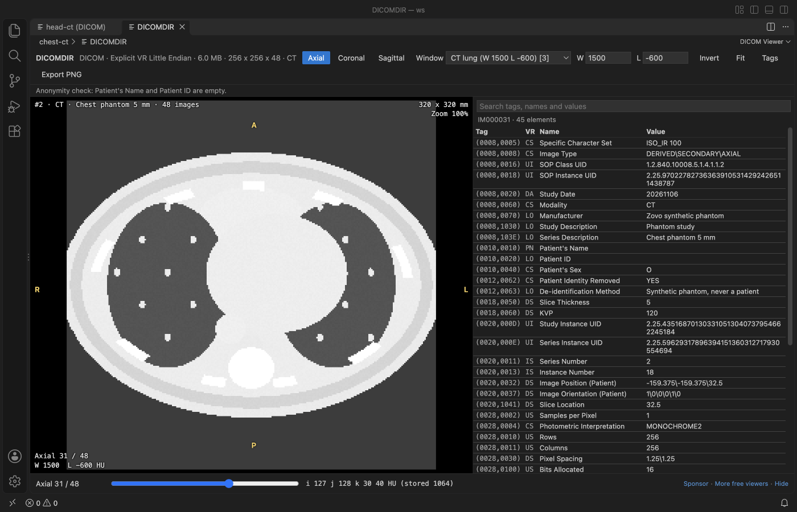
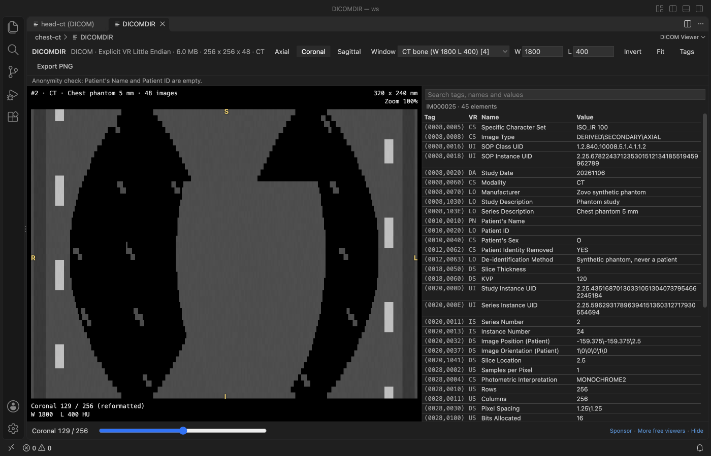
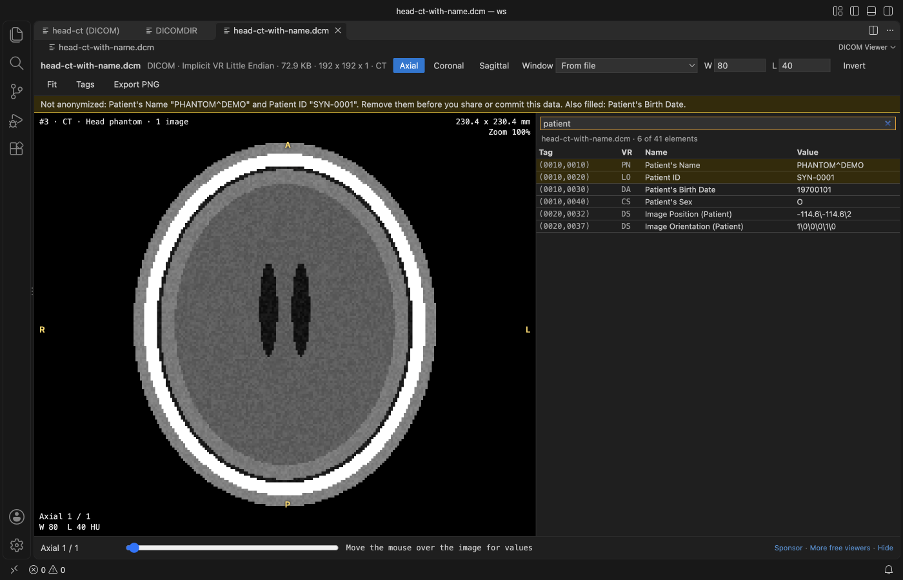
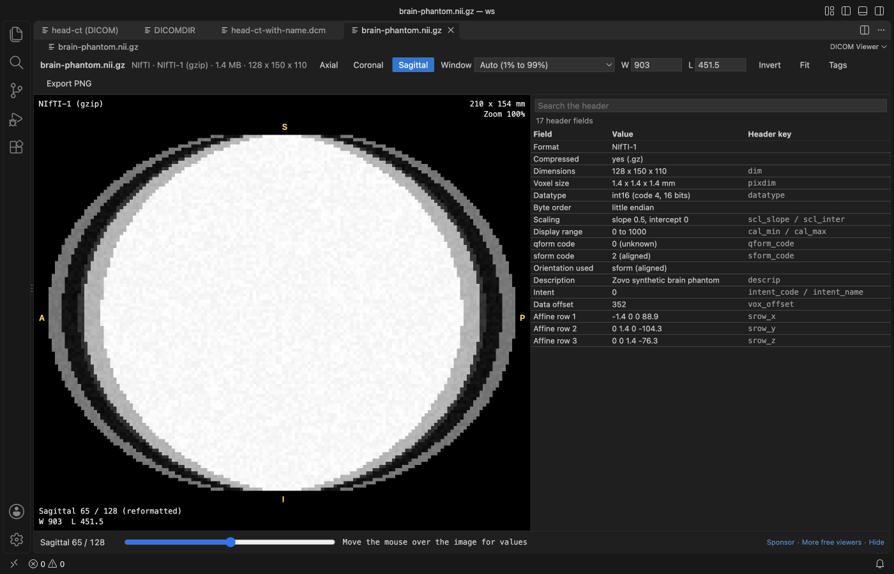

# DICOM Viewer & NIfTI Viewer for CT and MRI

Open CT and MRI scans in VS Code (single `.dcm` files, DICOM folders, `.nii` and `.nii.gz`) and scroll, window and inspect them without leaving the editor.

*Screenshot of VS Code 1.142 with a synthetic chest phantom made by `scripts/make-samples.js`. No patient data was used anywhere in this project.*

- Window presets for CT brain, soft tissue, lung and bone, or drag on the image to set width and level yourself.
- Axial, coronal and sagittal views of any series or volume, with the real slice spacing.
- The value under the cursor, in HU for CT, and a searchable tag table for every slice.
- A warning bar when Patient's Name or Patient ID is filled, so you don't commit data that isn't anonymized.
- Works offline. The scan is never changed.

## Quick start

1. Install DICOM Viewer & NIfTI Viewer for CT and MRI.
2. Click a `.dcm`, `.nii` or `.nii.gz` file, or a `DICOMDIR`. For a folder of slices, right-click the folder and pick Open Folder as DICOM Series.

## What you can do

| Action | How |
|---|---|
| Next or previous slice | Scroll, the arrow keys, Page Up and Page Down, or the slider |
| Window and level | Drag on the image (left and right for width, up and down for level), or type W and L |
| Presets | 1 CT brain (W 80, L 40), 2 soft tissue (W 400, L 40), 3 lung (W 1500, L -600), 4 bone (W 1800, L 400), 0 auto. The window stored in the file is also there |
| Views | Axial, Coronal and Sagittal buttons, or A, C and S |
| Zoom and pan | Ctrl or Cmd and scroll to zoom at the cursor, Shift and drag (or the right button) to pan, F or a double-click to fit |
| Invert | Invert button or I. MONOCHROME1 images open inverted already |
| Tags | Tags button or T. Search by tag number, name or value, double-click a row to copy it |
| Export | Export PNG saves the slice you see at its real proportions |

The bar under the image shows the voxel under the cursor as i, j and k, then the value. CT values are in Hounsfield units with the stored pixel value next to them. Letters on the image edges (R, L, A, P, S, I) show the patient direction when the file says it.

## Anonymity check

DICOM Viewer reads Patient's Name (0010,0010) and Patient ID (0010,0020) in every file of the series. When either is filled, a yellow bar names the values and counts the files, and those rows are marked in the tag table. It also lists other identifying tags it finds, such as the birth date, address, accession number or institution. When both are empty, a short grey line says so.

It's a check, not a de-identification tool. Burned-in text in the pixels and private tags aren't checked.

## Formats

| Format | What opens |
|---|---|
| DICOM transfer syntaxes | Implicit VR Little Endian, Explicit VR Little Endian, Explicit VR Big Endian, Deflated Explicit VR Little Endian and RLE Lossless |
| Not supported yet | JPEG Baseline, JPEG Extended, JPEG Lossless, JPEG-LS, JPEG 2000, HTJ2K and MPEG or HEVC video. These files still open with their full tag table and a message that names the transfer syntax |
| DICOM pixels | 8, 16 and 32 bit, signed or unsigned, MONOCHROME1, MONOCHROME2, RGB and YBR_FULL, single frame and multi-frame, Rescale Slope and Intercept applied |
| DICOM folders | A `DICOMDIR` (its Referenced File IDs), or any folder with `.dcm`, `.dicom` or `.ima` files or files without an extension, 4 folders deep. Slices are sorted by Image Position (Patient). With several series you pick one from a list |
| NIfTI | NIfTI-1 and NIfTI-2, `.nii` and `.nii.gz`, uint8 to float64 and RGB, with scl_slope and the sform or qform orientation. A 4D file shows one volume at a time, with a picker |

## Big scans

Files are read in a worker thread, so VS Code stays responsive. A 48-slice 256 x 256 series stacks in well under a second. Scans over 1024 MB (for `.nii.gz`, the unpacked size) show a message and aren't read. You can raise the limit with `dicomViewer.maxFileMB`, up to 4096.

## Settings

| Setting | Default | What it does |
|---|---|---|
| `dicomViewer.maxFileMB` | 1024 | Largest file or folder that is read |
| `dicomViewer.defaultView` | auto | View a scan opens in. Auto uses the plane the slices were stored in |
| `dicomViewer.smoothing` | false | Smooth pixels when zoomed |
| `dicomViewer.askForRating` | true | Ask one time for a Marketplace rating after a few days of use |
| `dicomViewer.showSupportLinks` | true | Show the small Sponsor and More free viewers links under the image |

## Privacy

No network calls and no telemetry. The webview has a strict Content-Security-Policy, file text is shown as plain text, and the only file DICOM Viewer writes is the PNG you choose in the save dialog.

## Known limits

- Views follow the stored voxel grid. Oblique scans are shown along their nearest patient axes and aren't resampled.
- Overlays, presentation states, segmentation objects, RT structures and DICOM SR content aren't drawn. Their tags show in the table.
- PALETTE COLOR images and 1-bit pixels aren't decoded.
- Not for diagnosis. It's a developer and research viewer.

## Support Zovo

Zovo extensions are free, with no ads and no tracking. They are made by [theluckystrike](https://github.com/theluckystrike) on GitHub. If this one saves you time, you can support the work:

- [Sponsor on GitHub](https://github.com/sponsors/theluckystrike)
- [Follow theluckystrike on GitHub](https://github.com/theluckystrike)

## More tools by Zovo

- [TIFF Viewer (16-bit, Float, GeoTIFF)](https://marketplace.visualstudio.com/items?itemName=zovo.tiff-viewer) opens 16-bit, float, multi-page and GeoTIFF images.
- [HDF5 & NetCDF Explorer (H5 Viewer)](https://marketplace.visualstudio.com/items?itemName=zovo.hdf5-netcdf-explorer) browses groups, attributes and values in HDF5 and NetCDF files and plots slices.
- [GGUF, Safetensors & NPY Viewer (NumPy Viewer)](https://marketplace.visualstudio.com/items?itemName=zovo.tensor-viewer) shows NPY, NPZ, Safetensors and GGUF tensors with stats and heatmaps.

See [all Zovo extensions on the Marketplace](https://marketplace.visualstudio.com/publishers/zovo).

## License

MIT. dicom-parser, nifti-reader-js and fflate are MIT too, see THIRD-PARTY-NOTICES.md.
